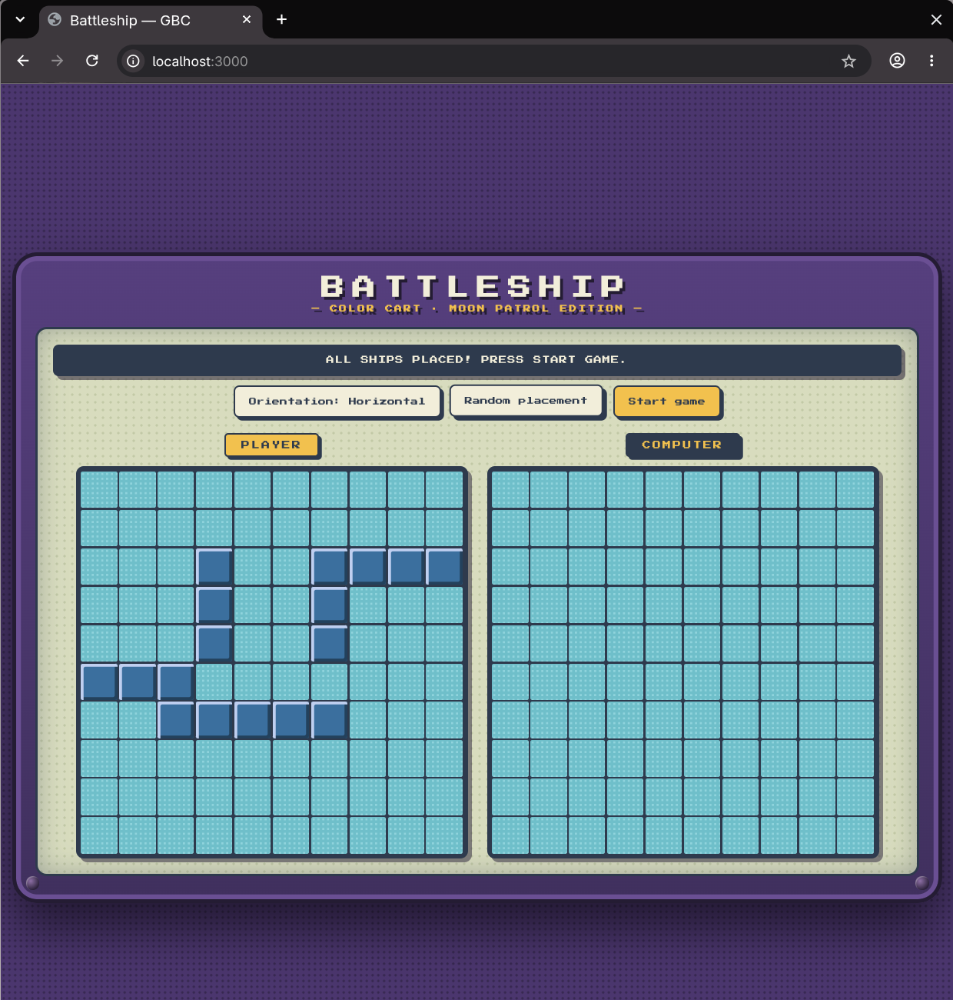
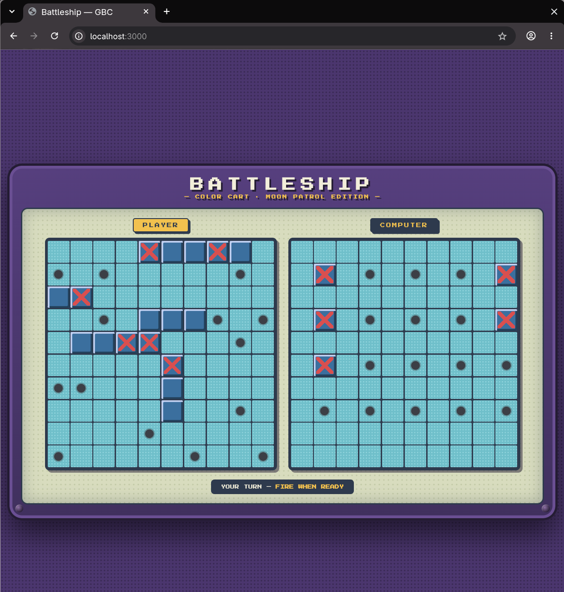

# Battleship — The Odin Project

A browser implementation of the classic **Battleship** game, built as The Odin Project
JavaScript assignment. Written in vanilla JavaScript with a Game Boy Color flavored UI.

## Screenshots

| Placement phase | Mid battle |
|---|---|
|  |  |

## What it does

- Full 10×10 naval battle against the computer.
- **Ship placement phase** before battle: place your own fleet by clicking cells,
  toggle between horizontal/vertical orientation, or let the computer place ships for you.
- **Full fleet**: Carrier (5), Battleship (4), Cruiser (3), Submarine (3) and
  Destroyer (2) on both boards.
- **Turn-based battle**: attack the computer board, the computer answers at random
  (choosing legal targets only — never the same cell twice).
- **Win/lose detection**: the game ends automatically when one side's fleet is sunk.
- **Visual feedback**: hit cells reveal the ship hull (+ red X), misses appear as dots;
  your placement stays hidden from your opponent until the game ends.

## Stack

- Vanilla JavaScript (ES modules, no framework, no build step in dev)
- HTML/CSS (hand-written)
- [Bun](https://bun.sh/) as runtime and test runner — `bun test`

## Getting started

Requires [Bun](https://bun.sh/) installed. The game has no dependencies.

```bash
bun test           # run the test suite (32 tests)
bunx serve src     # serve the game locally
```

Then open <http://localhost:3000/> in your browser and sink the computer's fleet.

## Project structure

```
src/
  index.html        # page: bezel + screen + panels
  main.js           # game module: wiring, turns, input, win/lose
  ship.js           # Ship: length, hits, isSunk()
  gameboard.js      # Gameboard: placement, attacks, allSunk(), getters for the UI
  player.js         # Player: holds a board, attacks the opponent's board
  ui.js             # rendering module: paints both boards from Gameboard state
  css/style.css     # GBC color-cart theme
  *.test.js         # bun unit tests (Ship, Gameboard)
```

## Design

- **Logic is separated from the DOM**: classes (`Ship`, `Gameboard`, `Player`) know
  nothing about the page; `main.js` orchestrates turns and `ui.js` only renders state.
  Re-rendering is full (option A): the view is a projection of the board, rebuilt from
  scratch after every change.
- **Secrets stay secret**: the opponent board render can't reveal ships — hit cells are
  revealed only *after* an attack lands there.
- **Phase-gated actions**: placement vs. battle logic is gated in the code (hidden UI is
  UX; the phase flag in `main.js` is the real lock).

## What I learned

- TDD as the default workflow (write the test, watch it fail, ship the implementation).
- Encapsulating game rules in classes and using small pure-ish functions for rendering.
- Separating canonical coordinates (0-index, game logic) from visual labels (1-index, human view).
- Designing a complete game loop with the computer as a random legal player.
- Keeping the UI honest: ship cells become visible only where they were actually hit.

## License

MIT
